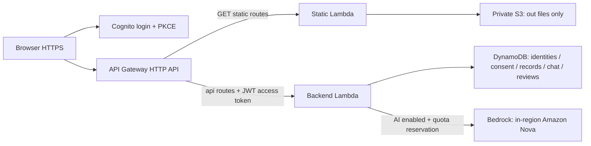

# Deploy Wellync บน AWS (ไม่มี CloudFront)

เป้าหมายคือ prototype สำหรับการแข่งขัน ไม่ใช่ระบบเวชระเบียนพร้อมใช้กับผู้ป่วยจริง



S3 website endpoint เปิดเว็บด้วย HTTPS ไม่ได้ จึงใช้ Lambda อ่านไฟล์จาก private S3 ผ่าน API Gateway บน origin เดียวกับ API วิธีนี้เหมาะกับ traffic ของ prototype แต่มีค่า API Gateway/Lambda/S3 ต่อการโหลดไฟล์ และจำกัดไฟล์ละ 4 MB ไม่มี CloudFront, NAT Gateway, EC2, RDS หรือ provisioned throughput

## 1. เตรียมเครื่องและบัญชี

- Node.js 22, npm, AWS CLI v2, AWS SAM CLI และ make
- ใช้บัญชีทีมของคุณเท่านั้น ตั้ง MFA สำหรับบัญชี AWS ตามข้อกำหนดผู้จัด และเข้าใช้งาน CLI ผ่าน SSO/temporary credentials ของผู้จัด
- ต้องมีสิทธิ์ CloudFormation, IAM role creation/PassRole, API Gateway, Lambda, S3, DynamoDB, Cognito และ CloudWatch ภายใต้ role ที่ได้รับ ถ้าถูก SCP/Challenger Access ปฏิเสธ ให้ส่งรายละเอียดให้ผู้จัดปรับสิทธิ์ ห้ามพยายามเลี่ยง policy
- Regions ที่ template อนุญาต: `us-east-1`, `ap-southeast-1`, `ap-southeast-7`
- เริ่มที่ `us-east-1` เมื่อจะทดสอบ Nova ตัวอย่างนี้ ตรวจ Bedrock ว่ารองรับ **in-region** ใน region ที่เลือกก่อนเปิด AI อย่าสลับไปใช้ `us.` / `global.` inference profile เพราะอาจวิ่งออกนอก regions ที่ผู้จัดอนุญาต
- ไม่ต้องใส่ AWS access keys หรือ model IDs ใน frontend

```bash
aws sts get-caller-identity
npm ci
npm --prefix lambda-backend ci
npm run check
npm run lint
npm run lint:security
sam validate --lint --template-file lambda-backend/template.yaml
```

สำหรับ dev แบบข้อมูลจำลอง ให้คัดลอก `.env.example` เป็น `.env.local` และใช้ `NEXT_PUBLIC_APP_MODE=demo` แล้ว `npm run dev` โหมดนี้ไม่เรียก AWS หรือ AI และเก็บเฉพาะข้อมูลตัวอย่างใน browser

หาก CloudFormation ติด `iam:GetRolePolicy` แต่สร้าง Lambda ผ่าน Console ได้ มีเส้นทางใช้ roles ที่เตรียมไว้ใน [docs/existing-roles.md](docs/existing-roles.md). ต้องมี roles แยกสองตัวและติดตั้ง runtime permissions ให้ครบก่อนทดสอบแอป

## 2. สร้าง stack ใหม่

ใช้ stack ใหม่ เช่น `wellync-prototype` โดยเฉพาะถ้าเคย deploy template เก่าที่สร้างตารางชื่อ `HealthcareAgentTable` แล้ว โครงสร้าง key และ authentication เปลี่ยนแล้ว ไม่รองรับการนำข้อมูลเก่ามาใช้ทันที และอย่าลบตารางเก่าเพื่อแก้ deployment error

```bash
cd lambda-backend
sam build
sam deploy --guided --stack-name wellync-prototype --region us-east-1
```

กรอก `CognitoDomainPrefix` ให้ไม่ซ้ำ เช่น `wellync-ชื่อทีม-เลขสุ่ม` ด้วยตัวอักษรอังกฤษตัวเล็ก ตัวเลข และขีดกลางเท่านั้น คง `AIEnabled=false`, `BedrockVisionModel` ว่างไว้ก่อน ยอมรับ IAM capabilities และเปิด change-set confirmation เพื่อตรวจทรัพยากรก่อนสร้าง

ไม่จอง Lambda reserved concurrency เป็นค่าเริ่มต้น เพื่อรองรับบัญชีที่มี quota ต่ำ โดยใช้ concurrency ส่วนกลางของบัญชีแทน API throttling และโควตา AI รายผู้ใช้/ส่วนกลางยังทำงาน แต่ไม่ได้เป็นเพดานจำนวน Lambda ที่ทำงานพร้อมกัน เปิด AI หลังตรวจ quota และ runtime permissions แล้วเท่านั้น; หากต้องการจำกัด concurrency ต่อฟังก์ชัน ให้ผู้ดูแลตรวจ quota ก่อนเพิ่ม reservation ใน template

SAM ใช้ Makefile ติดตั้ง dependencies และ compile TypeScript ให้เอง Handler คือ `dist/handler.handler` และ `dist/staticHandler.handler` ภายใต้ artifact ของแต่ละฟังก์ชัน

## 3. Build และ upload frontend

กลับมาที่ root ของ repository ใช้ชื่อ stack และ region เดียวกับที่ deploy:

```bash
cd ..
node scripts/aws-config.mjs wellync-prototype us-east-1
npm run build:aws
node scripts/publish-frontend.mjs wellync-prototype us-east-1
node scripts/publish-frontend.mjs wellync-prototype us-east-1 --apply
```

`publish-frontend.mjs` ตรวจ build manifest ว่าเป็น AWS mode และ Cognito config ตรงกับ stack แล้ว sync ไปที่ `FrontendBucketName` ของ stack เท่านั้น ค่าเริ่มต้นเป็น dry run; `--apply` จึง upload จริงและใช้ `--delete` ลบไฟล์ build เก่าที่ไม่มีใน `out/` ใช้ bucket นี้สำหรับ frontend อย่างเดียว ห้ามเก็บข้อมูลอื่นปน

`aws-config.mjs` อ่าน outputs เท่านั้นและเขียน `.env.aws.local` ที่ถูก git-ignore; `build:aws` บังคับใช้ค่า AWS ทับ `.env.local` เก่า จึงไม่เผลอ publish demo login หรือ API endpoint เดิม ไม่มี secrets อยู่ในไฟล์นี้ ตรวจ prefix ของ Cognito และ API จากบัญชีของคุณก่อน upload

เปิด `ApiEndpoint` เพื่อเข้าเว็บ ทั้งเว็บและ API ใช้ HTTPS บน origin เดียวกัน และ bucket เปิด Block Public Access ทั้งสี่ค่า ไม่ต้องเปิด S3 static website hosting หรือเปลี่ยน bucket ให้ public

## 4. สร้างบัญชีและผูกสิทธิ์

หากต้องการใช้รหัส OTP ทางอีเมลแทนรหัสผ่าน ดู [ขั้นตอน Email OTP](docs/email-otp.md) ซึ่งอัปเดต user pool เดิมหลังเตรียม SES และคงการตรวจ JWT/สิทธิ์ในฐานข้อมูล

1. เปิด Cognito User Pool จาก output `CognitoUserPoolId` สร้างผู้ใช้ 3 คนด้วยอีเมลที่ทีมรับข้อความได้จริง แยก patient, caregiver, doctor เชิญผู้ใช้และให้เปลี่ยน temporary password ผ่าน Cognito login
2. คัดลอก `scripts/demo-users.example.json` ไป `/tmp/wellync-demo-users.json` แล้วใส่ 3 อีเมลนั้น อย่าใส่รหัสผ่าน และอย่า commit รายชื่อจริง
3. อ่าน/preview script ก่อนเขียนข้อมูล:

```bash
node scripts/provision-demo.mjs wellync-prototype us-east-1 /tmp/wellync-demo-users.json
node scripts/provision-demo.mjs wellync-prototype us-east-1 /tmp/wellync-demo-users.json --apply
```

Script อ่าน Cognito `sub` ของผู้ใช้เดิมและสร้างข้อมูล **สังเคราะห์** 1 ผู้ป่วย / 1 ผู้ดูแล / 1 แพทย์ พร้อม 30 ค่าวัดและแผนตัวอย่าง ไม่มีประวัติยาสมมติ และไม่เขียนทับ item ที่มีอยู่แล้ว คำสั่ง dry run ไม่เขียน AWS; `--apply` เขียน DynamoDB และมีค่าใช้จ่ายตามการใช้งาน

Role, entity ID และ patient assignment อยู่ใน `USER#<Cognito sub> / PROFILE` ซึ่งสร้างได้เฉพาะ admin ไม่ได้อ่านจากอีเมลหรือ request body หากเปลี่ยนสมาชิก/role ภายหลัง ให้ผู้ดูแลตรวจและแก้ mapping โดยตรง ไม่ใช้ provision-demo เพื่อ overwrite ข้อมูลจริง

Patient consent เริ่มที่ `waiting` ให้ล็อกอินผู้ป่วยก่อนแล้วอนุมัติคำขอแพทย์ แพทย์จะยังไม่เห็นรายละเอียดสุขภาพหรือเรียก AI ของคนไข้จนกว่าจะอนุมัติ ผู้ดูแลไม่สามารถอนุมัติแทนได้

Cognito ใน template เปิด TOTP เป็น optional เพื่อลดความซับซ้อนการทดลอง ไม่มี public self-sign-up สำหรับการใช้จริงให้กำหนด MFA policy ของ app เพิ่ม ส่วน MFA ของบัญชี AWS เป็นข้อบังคับแยกต่างหาก

## 5. เปิด AI หลังทดสอบข้อมูล

ตรวจ model availability และสิทธิ์ในบัญชีจริงก่อน:

```bash
aws bedrock get-foundation-model --model-identifier amazon.nova-micro-v1:0 --region us-east-1
aws bedrock get-foundation-model --model-identifier amazon.nova-lite-v1:0 --region us-east-1
```

คำสั่งนี้ยืนยัน catalog เท่านั้น ไม่ยืนยันว่าเรียก inference ได้ ให้ทดสอบข้อความทั่วไปหนึ่งครั้งผ่านแอปหลังเปิด AI ถ้า model/SCP/region ไม่รองรับ ระบบต้องแสดง error และไม่เปลี่ยนเป็นข้อมูลจำลอง

แก้ค่า parameter ใน `lambda-backend/samconfig.toml` ที่ `sam deploy --guided` บันทึกไว้ หรือ deploy พร้อม overrides โดยรักษาค่าอื่นที่ใช้อยู่ ตัวอย่างสำหรับ stack ใหม่ข้างต้น:

```bash
cd lambda-backend
sam deploy --stack-name wellync-prototype --region us-east-1 --resolve-s3 --capabilities CAPABILITY_IAM --confirm-changeset --parameter-overrides CognitoDomainPrefix=YOUR_EXISTING_PREFIX AIEnabled=true BedrockModel=amazon.nova-micro-v1:0 BedrockVisionModel=amazon.nova-lite-v1:0 AIUserDailyUnits=200000 AIGlobalDailyUnits=2000000
```

- Text: Nova Micro, output สูงสุด 600 tokens
- Image: Nova Lite **เปิดแยกต่างหาก** ด้วย `BedrockVisionModel`, output สูงสุด 800 tokens รองรับ JPEG/PNG 1 ภาพ ไม่เกิน 500 KB และด้านละ 1024px หลัง resize
- Input: ไม่เกิน 3,000 ตัวอักษร; conversation ใช้ 3 turn ล่าสุดที่จำกัดความยาวแล้ว ไม่มีการเรียกโมเดลเพิ่มเพื่อสรุปประวัติ
- Model เลือกได้จาก server parameters เท่านั้น client ส่งโมเดลแพงหรือ `isCritical` เพื่อเลื่อน tier ไม่ได้
- 6 requests/นาที/ผู้ใช้, 200,000 budget units/วัน/ผู้ใช้ และ 2,000,000 units/วันรวม (UTC) หัก allowance แบบ atomic **ก่อน** เรียก Bedrock รวม output allowance และภาพเผื่ออีก 10,000 units
- Units ใช้ขนาดข้อความ UTF-8 แบบ conservative และ allowance ภาพ **ไม่ใช่จำนวน token จริงหรือ dollar hard cap** ดู `inputTokens/outputTokens` จริงใน CloudWatch log `ai_usage` ควบคู่กับ Billing
- ไม่มี SDK retries สำหรับ inference เพื่อเลี่ยงค่าใช้จ่ายซ้ำเมื่อ response หาย; request ล้มเหลวไม่คืน allowance เพื่อป้องกัน retry abuse
- ปิดฉุกเฉิน: deploy `AIEnabled=false`; ถ้าจำเป็นเร่งด่วน ผู้ดูแลตั้ง reserved concurrency ของ backend เป็น 0 ผ่าน Lambda console (API ข้อมูลทั้งหมดของ backend จะหยุดด้วย) แล้วคืนค่าผ่าน SAM ภายหลัง

ไม่มี Bedrock Guardrail resource ใน stack นี้ จึงไม่อ้างว่ามีการกรอง PII/เนื้อหาครบถ้วน ระบบจำกัดสิทธิ์/ข้อมูล context และห้าม execution แทน อย่าส่งข้อมูลคนไข้จริงใน prototype และตรวจ model output ก่อนใช้เสมอ ไม่เปิด Bedrock invocation logging ที่เก็บ prompts/responses ลง S3/CloudWatch สำหรับข้อมูลสุขภาพโดยไม่ออกแบบการคุ้มครองเพิ่มเติม

## 6. ตรวจหลัง deploy

- `GET /api/health` ได้ 200 และ `GET /api/state` ไม่มี token ได้ 401
- Cognito login/callback ทำงานทั้งสามบทบาท หลัง sign out ต้องกลับ login; เมื่อ access token หมดอายุ 15 นาที ต้อง sign in ใหม่ (ไม่เก็บ refresh token)
- Patient บันทึกค่าวัดใหม่แล้ว reload ยังเห็น; caregiver ยืนยันได้ และ patient แก้ค่าวัดที่ยืนยันแล้วไม่ได้
- Doctor ก่อน consent ไม่เห็น clinical details/records/plans; หลังอนุมัติเห็น และหลังปฏิเสธ/ถอน consent ใช้งาน clinical API ไม่ได้
- ลองเปลี่ยน `patientId` เป็นผู้ป่วยที่ไม่ถูกมอบหมาย ต้องได้ 403; เปลี่ยน doctorId/role/model ใน request ต้องถูกปฏิเสธ
- ร่าง care plan ของแพทย์อยู่ใน memory ของแท็บก่อน กด **อนุมัติและส่งแผน** จึงบันทึก AWS และให้ patient/caregiver เห็น; refresh ก่อนส่งจะสูญเสียร่างตามที่ UI แจ้ง
- ขอคำแนะนำเกี่ยวกับแผน/ปรับยา จะสร้างข้อเสนอ `PENDING`; เฉพาะแพทย์ที่มี consent ทบทวนได้ อนุมัติซ้ำได้ 409 การอนุมัติบันทึกผล review เท่านั้น การเผยแพร่แผนต้องผ่านหน้าของแพทย์อีกขั้น
- ทดสอบ AI disabled, quota exhausted, model failure, file invalid ต้องเห็น error โดยไม่มีข้อความว่าได้บันทึก/แจ้งแพทย์สำเร็จปลอม
- ข้อความที่ตรง emergency keyword ส่งคำเตือนทันทีโดยไม่เรียก AI; นี่เป็นเพียง keyword heuristic ไม่ใช่เครื่องมือคัดกรองฉุกเฉินครบทุกอาการ
- ทดสอบทั้ง browser ปกติและ mobile HTTPS รวมกล้อง อัปโหลดภาพ และ deep link `/patient/health/`

## 7. ต้นทุน การส่งงาน และการเก็บหลักฐาน

PDF ผู้จัดระบุ $350 รวมตลอดพัฒนา/ส่งงาน และ freeze ระบบวันที่ 25 ตุลาคม 2569 เวลา 23:59 (ไทย) วางแผนบันทึกวิดีโอและหลักฐานก่อนวันนั้น ตรวจอีเมลล่าสุดของผู้จัดเผื่อมีการเปลี่ยนกำหนด

ใช้ [AWS Pricing Calculator](https://calculator.aws/) ประเมิน **ตาม region และปริมาณใช้งานจริง** ใส่ API Gateway requests (รวม static assets), Lambda requests/GB-seconds, S3 storage/GET/PUT/data transfer, DynamoDB reads/writes/storage/PITR, Cognito MAU, CloudWatch logs และ Bedrock input/output/image tokens ไม่มีคำรับรอง "$0 base cost" และยังไม่ได้วัดค่าใช้จ่ายจริงในบัญชีนี้

เริ่มด้วย 100 sessions/วัน, 20 static requests/session และ 200 AI calls/วัน เป็นสมมติฐานสำหรับกรอก calculator แล้วปรับตาม log จริง ใช้ผล calculator แทนการคาดเดาราคา และเก็บ export/link ให้กรรมการเห็น

ตรวจ alerts 50/80/90/100% และ circuit breaker ของผู้จัดในบัญชีทีมด้วย ถ้าจะสร้าง budget เพิ่มใช้ threshold ที่ต่ำกว่าเครดิตที่เหลือมากพอให้ตอบสนองได้ AWS Budgets แจ้งเตือนไม่ใช่ตัวตัดการใช้งานทันที; daily AI limits ก็ไม่ครอบคลุมค่า traffic/static/storage

CloudWatch alarm ใน template มีสถานะใน console แต่ **ยังไม่มี email/SNS notification destination**. API access log ไม่เก็บ body/token และ Lambda log เก็บเฉพาะ error type/จำนวน tokens; ประวัติ chat/ข้อเสนอมี TTL 30 วัน ส่วน clinical data/consent/identity ไม่มี TTL อัตโนมัติ

DynamoDB, Cognito User Pool และ S3 ถูก `Retain` เมื่อ delete stack ข้อมูลและค่า storage/PITR อาจยังอยู่ ให้ตรวจ retention/สำรอง/owner กับทีมก่อนลบทรัพยากรจริง SAM artifact bucket ที่ `--resolve-s3` สร้างก็อาจยังอยู่ ห้ามคิดว่า `sam delete` ล้างค่าใช้จ่ายทั้งหมด
