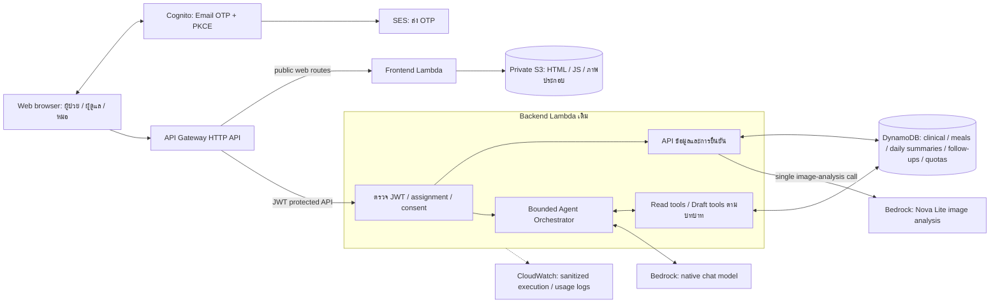
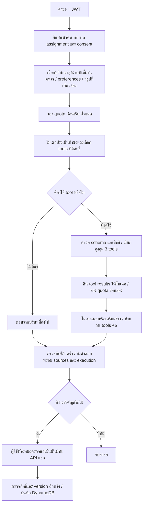
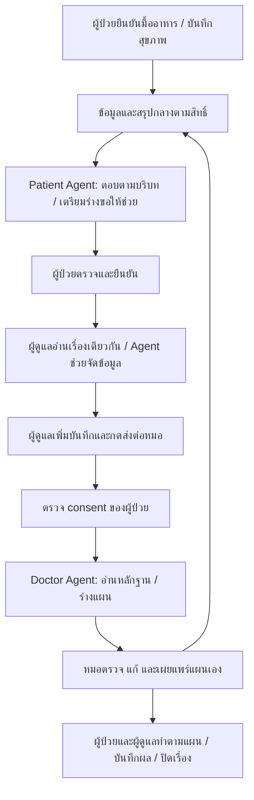

# Wellync architecture และ Agent workflow

ตรงกับ `judging-ready-20261023-v1`; ต้อง deploy/verify ก่อนอ้างว่าเป็นความสามารถใน AWS ปัจจุบัน

## AWS runtime

IAM กำหนดสิทธิ์ของแต่ละ service ไม่ใช่จุดผ่านของข้อมูล Frontend/Backend เป็นคนละ API integration ไม่ใช่ Lambda เรียกต่อกัน S3 ไม่เก็บภาพอาหารต้นฉบับ Chat กับภาพไม่มี external model provider API หรือ Marketplace endpoint

## การทำงานของ Agent หนึ่งคำขอ

Planning คือการเลือกข้อมูล/เครื่องมือให้เหมาะกับคำขอ ไม่ใช่การแสดง hidden chain of thought คำถามที่บริบทพร้อมแล้วจบใน 1 model call คำถามที่ใช้ tools ไม่เกิน 2 calls; การรอคนยืนยันไม่เปิด Lambda หรือโมเดลค้างไว้

## วงจรผู้ใช้ทั้งสามบทบาท

เป็นสามบทบาทเชิงตรรกะใน backend เดียว ไม่มีสามโมเดลคุยกันใน background หรือ agent ที่ส่งข้อมูลข้ามผู้ป่วยเอง ผู้มีสิทธิ์ต้องเปิด inbox ในเว็บ ภาพนี้แสดงขอบเขตการทำงานร่วมกัน ไม่ได้แปลว่าทุกขั้นเรียกโมเดลเสมอ
